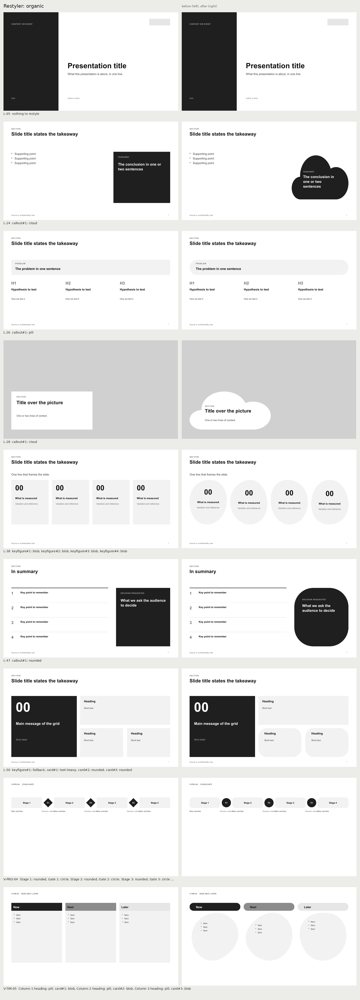

<div align="center">

[](https://github.com/MaximeRumpler/Make_Style_PPTX)

*Give your clean deck another look. Same content, same figures, new shapes and layouts.*

<sub lang="fr">En français : donnez un autre style à votre présentation, sans changer son contenu.</sub>

[](https://github.com/MaximeRumpler/Make_Style_PPTX/actions/workflows/ci.yml)
[](LICENSE)
[](#install)
[](https://github.com/MaximeRumpler/Make_PPTX)

</div>

* * *

<div align="center">

[](docs/restyle-organic.png)

</div>

## What it does

Make_Style_PPTX is a *skill*: a folder of instructions and small tools that an AI assistant such as Claude or Codex uses to restyle presentations.

[Make_Clean_PPTX](https://github.com/MaximeRumpler/Make_Clean_PPTX) gives your notes their **form**: one message per slide, a matching design and chart. Make_Style_PPTX gives the same deck a **look**: the cards leave the square-box shape, some slides take a staggered or arced layout, covers and dividers get a quiet background. Your text, your figures and the order of your slides stay exactly as they are, and the skill always writes a copy.

Two styles are ready today:

| **Organic** | **Paper** |
|:---|:---|
| Cards become pebbles, callouts clouds, key figures round discs; a soft mist behind covers, statements and dividers. For workshops, training, a warmer tone. | Cards become torn sheets, callouts tickets, key figures sketched by hand; a faint squared-paper grid behind covers, statements and dividers. For notes, field reports, a crafted feel. |

When a text would no longer fit a new shape, that card keeps its standard shape: a style never cuts or shrinks your words.

* * *

## Install

| **Claude Code** | **Codex, Cursor, Copilot, Gemini CLI and others** | **Claude.ai or Claude desktop** |
|:---|:---|:---|
| `/plugin marketplace add MaximeRumpler/Make_PPTX`<br>then `/plugin install make-style-pptx@make-pptx` | `npx skills add MaximeRumpler/Make_Style_PPTX`<br>It asks which assistant you use. Needs [Node.js](https://nodejs.org). | A ready-to-upload zip comes with the first release. Until then, use one of the first two columns. |

It needs Python 3.9 or later on your computer; the skill tells you if anything is missing. The before and after images also need LibreOffice. Install [Make_Clean_PPTX](https://github.com/MaximeRumpler/Make_Clean_PPTX#install) too if you want to make the deck in the same conversation.

**Update**: Claude Code, `/plugin marketplace update make-pptx`; other assistants, run the `npx skills add` line again.

## Use

Make a deck with Make_Clean_PPTX, or give it one, then ask in your own words:

```text
Give this deck the organic style.
Make my-deck.pptx look less boxy, keep the content.
Donne un style « papier » à cette présentation, avec quelques slides en escalier.
```

It may ask one quick question first: the style, and how many slides get a special layout (*calm*, *balanced* or *bold*). Every choice has a default.

* * *

## How it works

| **Shapes** | **Restyle** | **Arrange** | **Ambience** |
|:---|:---|:---|:---|
| Drops, clouds, pebbles, tickets, speech bubbles, torn paper and filled icons, as native and editable PowerPoint shapes ([contact sheet](docs/shapes-contact-sheet.png)) | Cards, callouts, key figures and labels take the style's shape; their text moves into the shape's safe box ([organic](docs/restyle-organic.png), [paper](docs/restyle-paper.png)) | A few slides lay their units out as a stagger, a cascade, an arc or a deconstructed grid ([examples](docs/arrange-deck.png)) | One quiet motif behind covers, statements and dividers: mist, rain or a fine grid ([mist](docs/ambience-mist.png), [grid](docs/ambience-grid.png)) |

**How many special slides.** An arranged slide stands out, so the right number depends on your request, your audience and the tone of the content: none for a board update, more for a keynote or a workshop. *Calm*, *balanced* and *bold* are starting points, not limits, and you can name the slides yourself.

**Checked before delivery.** Text that would overflow, overlap another block or leave the margins keeps its plain layout. Background motifs never go on dense slides, and any part that would make a text harder to read than WCAG's 4.5:1 is left out. Same deck and same style always give the same file.

The styles are files: a style pack works with Make_Clean_PPTX's libraries, and Make_Colors_PPTX can add your brand colours on top. Details in [references/restyler.md](skills/make-style-pptx/references/restyler.md).

* * *

## The Make PPTX set

Part of [**Make PPTX**](https://github.com/MaximeRumpler/Make_PPTX), three skills that take your notes to a finished deck. Each one works on its own.

| **Make_Clean_PPTX** | **Make_Style_PPTX** | **Make_Colors_PPTX** |
|:---|:---|:---|
| **Form.** Notes in, a clean deck out: one message per slide, tested layouts and charts. | **Look.** The same deck in another style: other shapes, arrangements and backgrounds. | **Brand.** Your colours, fonts and logo, from your brand guidelines, website or example files. |
| [Install](https://github.com/MaximeRumpler/Make_Clean_PPTX#install) · [Gallery](https://maximerumpler.github.io/Make_Clean_PPTX/) | Preview · [Install](https://github.com/MaximeRumpler/Make_Style_PPTX#install) | Preview · [Install](https://github.com/MaximeRumpler/Make_Colors_PPTX#install) |

*Start with Make_Clean_PPTX for the structure. Add a style and your brand colours when you need them.*

* * *

## Licence

[EUPL-1.2](LICENSE), the open source licence of the European Union: free to use; if you share an improved version, share it under the same licence. **You own the decks and styles you make.** The EUPL does not apply to them and no attribution is required ([NOTICE](NOTICE)).

<div align="center">

Built by [**Maxime Rumpler**](https://github.com/MaximeRumpler) · [](https://github.com/KairosTech-fr) · [kairostech.fr](https://kairostech.fr)

<sub>With thanks to the creators and contributors of [impeccable](https://github.com/pbakaus/impeccable), whose design skills for AI agents inspired this set, and of Wikipedia's [Signs of AI writing](https://en.wikipedia.org/wiki/Wikipedia:Signs_of_AI_writing), which guides how its texts are written.</sub>

<p align="right">
  
</p>

</div>
